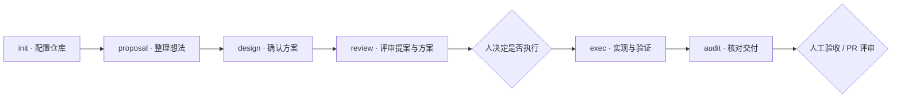

# VAPA Skills

<p align="center">
  给使用 AI Coding Agent 的团队，一套从提案、评审到执行与验收的协作 Skills。<br>
  <strong>人决定做什么，Agent 留下做事的依据。</strong>
</p>

<p align="center">
  简体中文 · <a href="README.en.md">English</a> · <a href="docs/framework.md">完整框架</a> · <a href="https://github.com/insentek/VAPA/issues">讨论与反馈</a><br>
  <sub>v0.1-draft · 早期公开预览 · CC BY-SA 4.0</sub>
</p>

## AI 能写代码，团队仍需要把事情讲清楚

一个想法发给 Agent，很快就能得到代码。但到了评审时，团队还需要回答：为什么做？范围是谁确认的？测试证明了什么？谁来判断可以交付？

VAPA 把这些问题接到同一条工作流里。想法先变成可以讨论的 GitHub Issue，团队决定是否执行；Agent 按明确范围实现，保存计划、变更和验证记录；审计再把实现对回验收标准，交给人判断。

**你会得到：**

- **更清楚的任务入口。** 提案写明具体问题、证据、边界和验收标准。
- **更容易接手的执行记录。** 计划、关键判断和测试证据留在仓库，不只留在聊天里。
- **有依据的交付评审。** 审计逐项核对范围与验收条件，明确哪些已验证、哪些仍有缺口。

VAPA 的全称是 **Vision-driven · Async · Proposal-based · Agent-executed**：用愿景确定方向，通过异步提案协作，由 Agent 承担执行。

## 一条工作流，六个 Skills



- **[`vapa-init`](skills/vapa-init/SKILL.md) · 给协作打地基。** 检查 GitHub 配置，确认后配置状态标签与四类 Issue 模板，帮助团队建立 `VISION.md`。
- **[`vapa-proposal`](skills/vapa-proposal/SKILL.md) · 把一句想法写成可讨论的提案。** 结合仓库上下文补齐问题、范围与验收标准，预览确认后创建草稿 Issue。不带主题时列出待定提案。
- **[`vapa-design`](skills/vapa-design/SKILL.md) · 把方案逐项谈清楚。** 结合现有实现，讨论数据、接口、交互和迁移等设计；每项经你确认后才发布为 Issue 评论，并在任务工作区保留设计记录。
- **[`vapa-review`](skills/vapa-review/SKILL.md) · 在写代码前找出缺口。** 阅读 Issue 正文和评论，给出有原文依据的结构化评审。结果只显示在对话里，不发评论、不改标签，也不代替团队批准提案。
- **[`vapa-exec`](skills/vapa-exec/SKILL.md) · 按已确认范围执行。** 检查执行条件，建立项目内工作区，保存契约、关键决策、测试证据与 PR 草稿。执行方式由 Agent 按工作本身选择；范围与验收仍由人决定。
- **[`vapa-audit`](skills/vapa-audit/SKILL.md) · 把交付对回承诺。** 检查实际 diff、测试和执行记录，返回可评审、需返工或需人决策的结论。优先使用独立 Agent / 会话；同一会话的自审须明确披露。

你可以先用 `vapa-review` 评审一个现有提案，再决定是否引入完整流程。

## 开始使用

### 1. 安装 Skills

在你的项目目录中运行：

```bash
npx skills add insentek/VAPA
```

按安装器提示选择需要的 Skills 和 Agent。也可以先查看列表，或只装一个：

```bash
npx skills add insentek/VAPA --list
npx skills add insentek/VAPA --skill vapa-review
```

需要 Node.js / npm 才能运行 `npx`。Skills 的发布源是本仓库的 `skills/` 目录。安装选项见 [Skills CLI 官方说明](https://github.com/vercel-labs/skills#readme)。安装器支持多种 Agent，不等于本项目已在所有宿主上完成端到端验证。

### 2. 从一个真实任务开始

打开有 GitHub `origin` 的项目。下面是发送给 **Codex 的对话请求**，不在终端运行；将占位 URL 换成实际提案链接：

```text
$vapa-init 检查当前仓库，展示配置变更后再初始化。

$vapa-proposal 起草提案：让运营人员按日期批量导出设备数据。
先帮我明确使用者、导出范围和验收标准，给我完整预览。

$vapa-design <完整 GitHub Issue URL>
和我逐项讨论方案，每项确认后再记录为 Issue 评论。

$vapa-review <完整 GitHub Issue URL>
```

团队完成评审、明确批准执行后：

```text
$vapa-exec 执行已批准的提案：<完整 GitHub Issue URL>

$vapa-audit 审计 .vapa/vapa-exec-<issue-number>/workspace/
核对实际 diff、验收条件和测试证据。
```

在 **Claude Code** 中，将 `$技能名` 换成 `/技能名`，例如 `/vapa-review <完整 GitHub Issue URL>`。安装后若未发现技能，重新打开会话，并检查安装器是否选择了当前 Agent 和项目。

### 3. 满足对应的前置条件

- **GitHub 访问：** 仓库启用 Issues；安装 [GitHub CLI](https://cli.github.com/)，用 `gh auth login` 登录、`gh auth status` 检查。`vapa-review` 只需要读取权限；初始化、提案提交和设计评论需要相应写权限。
- **脚本运行：** Bash、Python 3；初始化标签还需要 `requests`（`python3 -m pip install requests`）。
- **完整组织配置：** 组织管理员预先配置 Issue Types，以及 `Align` / `Size` 字段。`vapa-init --init-fields` 可以创建或更新四个贡献者字段，影响整个组织；字段类型不匹配时会停止。
- **宿主能力：** Agent 需要读取仓库、运行命令；`vapa-exec` 需要写文件和执行项目测试。脚本路径相对于实际安装的 Skill 解析，不依赖 Claude 环境变量。`init`、`proposal`、`design`、`review` 的 Codex 显式调用策略放在各自的 `agents/openai.yaml` 中；写入前的预览确认仍保留。

六个 Skills 已通过包格式校验和本地 Codex 加载器检查。这确认了包格式、发现和元数据加载；完整的真实 GitHub 写入验收仍需单独进行。

初始化会直接修改远程标签，并通过 GitHub Contents API 向默认分支提交四个 Issue 模板。Skill 会先展示目标与变更让你确认；建议先在试用仓库走一遍。个人仓库可以先单独试用只读评审，完整组织字段流程仍以组织仓库为目标。

## 看看一次任务会留下什么

以“按日期批量导出设备数据”为例：

1. **提案**说明谁需要导出、日期边界、权限要求，以及怎样判断结果正确。
2. **设计与评审**先确认方案，再检查证据与验收是否充分，团队决定是否做、何时做。
3. **执行**把每条验收条件对应到实现步骤与验证方式。
4. **审计**检查实际代码和证据，将缺口退回执行，或交给人做决定。

执行与审计记录保存在项目中：

```text
.vapa/vapa-exec-<issue-number>/workspace/
  design/                # 已确认设计的本地归档（适用时）
  state.json             # version 1 当前快照：阶段、活跃状态、审计与同步
  events.jsonl           # 实际事件，追加记录，供恢复与观察
  issue.json             # 原始提案快照
  comments/              # 讨论记录
  images/                # 引用图片（适用时）
  issue-brief.md         # 逐字引用的验收条件与边界、来源、准入结论
  evidence/              # 验证证据，UI 任务须有视觉证据
  VAPA_EXEC_PLAN.md      # 代码库发现、关键决策、执行策略与验证计划
  VAPA_EXEC_LOG.md       # Git 无法记录的判断、偏离与阻塞
  TEST_REPORT.md         # 验证结果与未覆盖项
  PR_DRAFT.md            # 供人工审阅的 PR 草稿
  VAPA_AUDIT.md          # 审计结论与证据
```

状态与事件格式见 [执行状态契约](skills/vapa-exec/references/execution-state.md)。附带只读检查工具，可检查记录一致性并计算依赖就绪任务；它不负责启动 Agent 或写 GitHub。只有需要人单独查看或验收的交付才拆成子 Issue；Agent 内部的并行与细分无需建 Issue。调度按直接依赖就绪进行，无需等待整波完成。

UI 任务还需要 `ui-spec.md`；拆成子 Issue 的任务还需要父任务的 `decomposition.md`。设计阶段只创建 `design/`，执行阶段再补齐状态和其余记录。拆分执行与父子任务交接见 [执行模型](docs/exec-parent-child-model.md)。

这些记录在脱敏后可以随实现提交。审计返回 `READY_FOR_PR` 表示具备进入人工评审的条件；子任务的 `READY_TO_INTEGRATE` 只表示可以回到父分支集成。最终验收与合并仍由人决定。

## 适合怎样的团队

适合已经使用 GitHub Issues 和 AI Coding Agent，希望把需求、执行与验收接起来的团队；也适合需要跨人、跨会话接手任务的维护者。

很小的改动可以继续直接处理。建议先让一个范围清楚的小提案走完流程，再按需要引入完整框架中的 Roadmap、Steward 轮值和贡献记录。

## 当前能力与发布状态

当前为 **`v0.1-draft` 早期公开预览**。仓库提供六个可安装 Skills、提案模板、GitHub 辅助脚本及设计 / 执行 / 审计协议。

委员会评审、优先级取舍、人工验收由团队完成；GitHub Projects / Roadmap 自动配置、完整生命周期自动流转和贡献积分自动统计尚未提供。执行协议要求在关键阶段同步进展，但依赖 Agent 与宿主实际执行。多 Agent 编排也依赖宿主能力。

`VEP-XXXX` 是便于阅读的提案编号；并发提交可能重复，编号扫描最多覆盖 1,000 条匹配记录。追踪任务应以 GitHub Issue 编号 / URL 为准。

本轮设计审查、修复和仍需验证的部分见 [Skills 设计审查](docs/skill-design-review.md)。

## 深入了解与参与

- [完整框架](docs/framework.md)：愿景、提案、评审、执行和贡献机制。
- [执行与父子任务模型](docs/exec-parent-child-model.md)：拆分、集成和审计如何交接。
- [提交问题或建议](https://github.com/insentek/VAPA/issues/new/choose)：带上你的场景、宿主与执行结果。
- 改进 Skill 时，将入口保持聚焦，把模板放到 `references/`，确定性操作放到 `scripts/`。

包格式、文档链接与脚本检查：

```bash
python3 -m pip install -r tests/requirements.txt
python3 tests/check-skills.py
python3 tests/check-docs.py
bash tests/test-vapa-init.sh
bash tests/test-vapa-proposal.sh
bash tests/test-vapa-review.sh
```

已安装 Codex CLI 时，可运行 `node tests/test-codex-loading.cjs`，在隔离目录检查实际技能加载，不启动模型或写入 GitHub。

## 许可

[CC BY-SA 4.0](LICENSE)。转载与改编请署名，并遵循相同方式共享。
